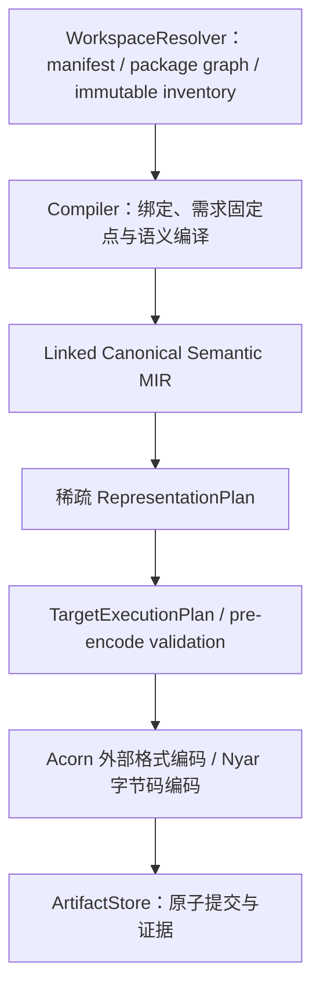

# Valkyrie 编译器架构

本文固定生产编译协议与事实所有权。接口合同不证明某个 target 已完成；能力须由对应修订的正式构建与真实执行证明。

## 生产入口与所有者

Legion 只编排 WorkspaceResolver、Compiler、ArtifactStore；不直接构造 AST/HIR/MIR 或语义选择结果。Compiler 不自行读取工程文件。

Oak 生产语法树、恢复状态和 syntax diagnostics。Valkyrie frontend 生产名称、类型、泛型替换、trait/imply evidence、调用与 package Semantic MIR；当前实现位于外部 Nyar 仓的 nyar-language。Nyar 框架负责通用验证、优化、表示与降低；Acorn 负责外部格式编解码。

## 声明绑定与语义需求

inventory 是完整来源集合；声明索引提供签名、导出、类型与可见性；语义需求决定物化哪些 body。索引、绑定、类型与实例/evidence 需求协作到固定点，不能先全库 body lowering 再裁剪。

每个物化 body 都须有入口 export 经声明/实例/evidence 到该 body 的合法需求链。短名恰好唯一不证明可见，文件被选中不证明同文件所有 body 可达。无计划、显式空需求和非空需求未物化分别处理。

## 调用、类型与表示

AST operator 在 HIR 展开为普通 callable。HIR/MIR/LIR 不建立 unary/binary/operator 语义类别；用户函数、std、trait/imply 和展开后的 operator 共用实例解析，Semantic MIR 用 Invoke(callee, arguments)。

ItemInstanceId 关联声明、完整 substitution、签名及 evidence。字段/变体引用所属完整名义实例。同声明不同实参不能混用，Self、Cast 目标及关联类型等全部类型位共用绑定事实。

linker 选择 target-conditioned adaptor/import；表示规划只选择 carrier/layout。RepresentationPlan 是稳定语义 ID keyed 的稀疏侧表，不复制 CFG。backend 只编码已验证 TargetExecutionPlan，不能按 callee、field、类型名或 carrier 补语义。

## 恢复、诊断与工具

Oak 同时返回可用树、recovery/missing/error 与 diagnostics，保留后续有效声明。恢复不能缺 token 补普通值，parser 不检查 place/type，Compiler 按可达语义决定准入。

各阶段保留 stage/code/owner/source/span，Compiler 汇总诊断。Lint 不另设语言合法性；工程 check/LSP 共享工程快照。源码 formatter 由 Oak CST/token-gap 生成 edits，Nyar PP document 仅打印模型，不替代源码格式化。

## 验收

修复前写清行为、缺事实、唯一生产者、消费接口和失败方式。测试成对覆盖可达/不可达、同名不同 owner/namespace、未声明依赖、跨包调用、实例与 evidence。缺身份必须结构化失败。

分别记录机制删除、合同成立和真实交付证据。局部测试、错误文本变化、枚举删除和字符串扫描均不替代 artifact/export/invoke 及题意测试。删除须迁移消费者、删除依赖与实现并验证旧生产入口不可达。
