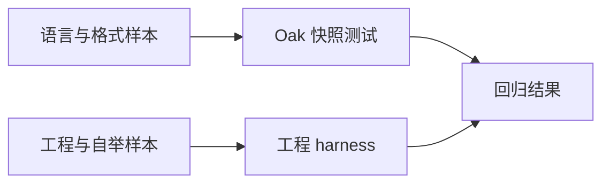

# Valkyrie 测试语料

这里收集 Valkyrie、VON、AWSL 及 Legion 工程样本。解析器维护者可用快照比较语法树和文本输出，工程工具维护者可用完整工程验证规划、构建与运行行为。

Valkyrie、VON 和 VOC 的 crate 提供各格式测试入口；Legion 语料通过 `legion_fixtures::root()` 访问。具体用法见各项目的 README。
