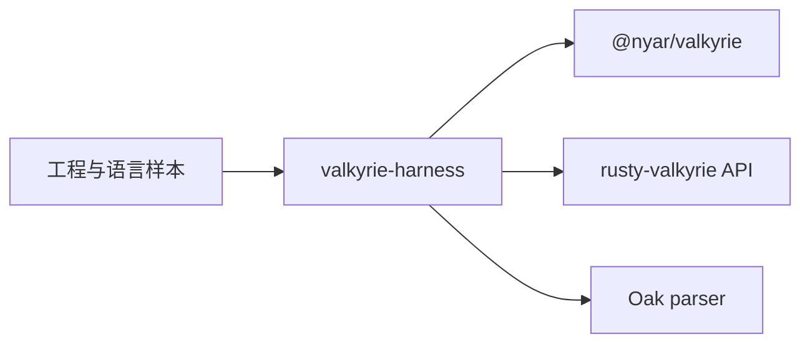

# valkyrie-harness

Valkyrie 工程与语法回归的测试工具。它通过 `@nyar/valkyrie` 命令行和 `rusty-valkyrie` Rust API 检查工程规划，并使用 Oak 验证语言样本。



## 运行

在仓库根目录安装 Node.js 依赖，再运行 Rust 测试：

```sh
pnpm install
cargo test -p valkyrie-harness
```

`VALKYRIE_LEGION` 可指定用于测试的 Legion 入口。使用本机产品包时，可参考 [package.local.json.example](package.local.json.example) 中的依赖配置；Rust 依赖配置见仓库的 [.cargo/config.example.toml](../../../.cargo/config.example.toml)。
